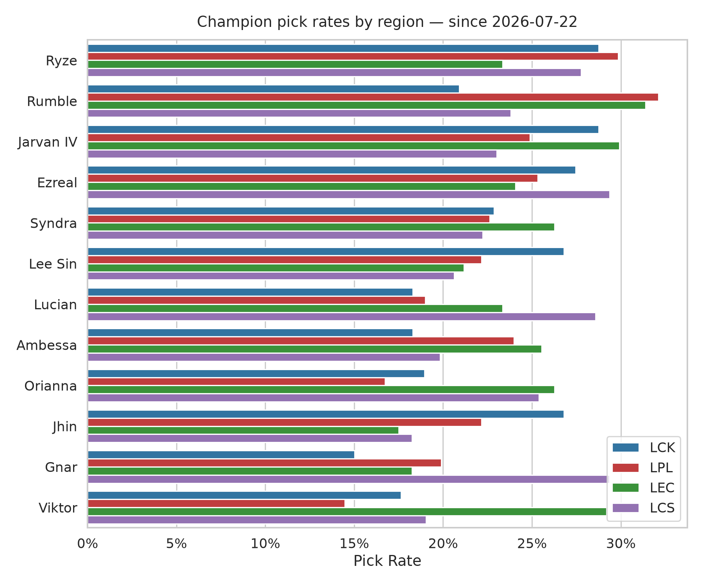
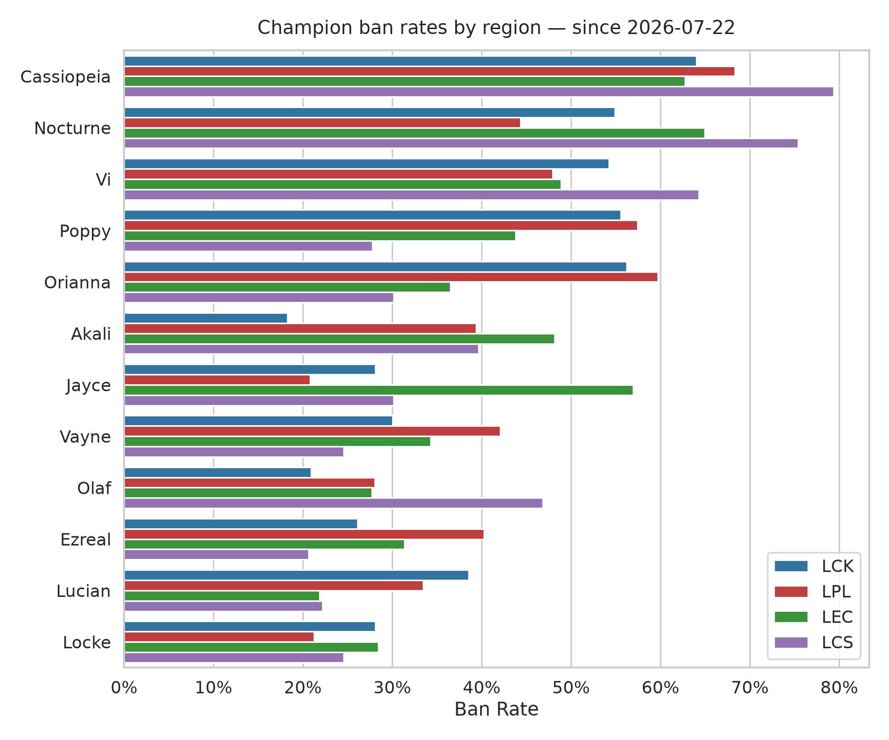
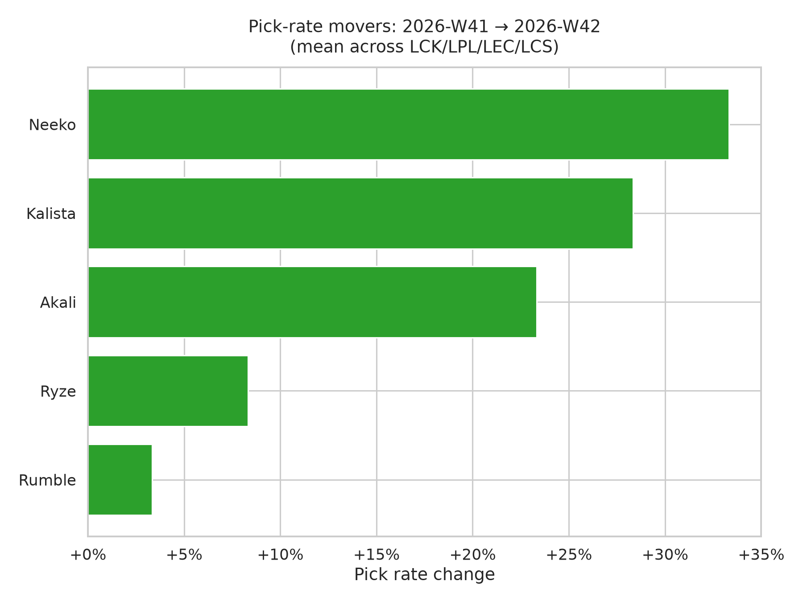

# Cross-League Meta Report — 2026-11-02

Games from **2026-07-22** through **2026-10-13**.

## Games analyzed

| League | Games |
|---|---|
| LCK | 153 |
| LPL | 221 |
| LEC | 137 |
| LCS | 126 |

## Charts

## Cross-league pick rates (top 15 by mean)

| Champion | LCK | LPL | LEC | LCS | Mean |
|---|---|---|---|---|---|
| Ryze | 29% | 30% | 23% | 28% | 27% |
| Rumble | 21% | 32% | 31% | 24% | 27% |
| Jarvan IV | 29% | 25% | 30% | 23% | 27% |
| Ezreal | 27% | 25% | 24% | 29% | 27% |
| Syndra | 23% | 23% | 26% | 22% | 23% |
| Lee Sin | 27% | 22% | 21% | 21% | 23% |
| Lucian | 18% | 19% | 23% | 29% | 22% |
| Ambessa | 18% | 24% | 26% | 20% | 22% |
| Orianna | 19% | 17% | 26% | 25% | 22% |
| Jhin | 27% | 22% | 18% | 18% | 21% |
| Gnar | 15% | 20% | 18% | 29% | 21% |
| Viktor | 18% | 14% | 29% | 19% | 20% |
| Milio | 18% | 19% | 17% | 25% | 20% |
| K'Sante | 18% | 20% | 16% | 25% | 20% |
| Jayce | 22% | 19% | 17% | 21% | 20% |

## LCK

**Top picks**

| Champion | Rate | Games |
|---|---|---|
| Jarvan IV | 29% | 44 |
| Ryze | 29% | 44 |
| Ezreal | 27% | 42 |
| Jhin | 27% | 41 |
| Lee Sin | 27% | 41 |
| Olaf | 25% | 39 |
| Pantheon | 23% | 35 |
| Shen | 23% | 35 |
| Syndra | 23% | 35 |
| Jayce | 22% | 34 |

**Top bans**

| Champion | Rate | Games |
|---|---|---|
| Cassiopeia | 64% | 98 |
| Orianna | 56% | 86 |
| Poppy | 56% | 85 |
| Nocturne | 55% | 84 |
| Vi | 54% | 83 |
| Camille | 43% | 66 |
| Bard | 42% | 64 |
| Lucian | 39% | 59 |
| Vayne | 30% | 46 |
| Jayce | 28% | 43 |

## LPL

**Top picks**

| Champion | Rate | Games |
|---|---|---|
| Rumble | 32% | 71 |
| Ryze | 30% | 66 |
| Naafiri | 28% | 62 |
| Ezreal | 25% | 56 |
| Jarvan IV | 25% | 55 |
| Ambessa | 24% | 53 |
| Seraphine | 23% | 51 |
| Syndra | 23% | 50 |
| Jhin | 22% | 49 |
| Lee Sin | 22% | 49 |

**Top bans**

| Champion | Rate | Games |
|---|---|---|
| Cassiopeia | 68% | 151 |
| Orianna | 60% | 132 |
| Poppy | 57% | 127 |
| Vi | 48% | 106 |
| Nocturne | 44% | 98 |
| Vayne | 42% | 93 |
| Ezreal | 40% | 89 |
| Akali | 39% | 87 |
| Lucian | 33% | 74 |
| Jarvan IV | 31% | 68 |

## LEC

**Top picks**

| Champion | Rate | Games |
|---|---|---|
| Rumble | 31% | 43 |
| Jarvan IV | 30% | 41 |
| Viktor | 29% | 40 |
| Orianna | 26% | 36 |
| Syndra | 26% | 36 |
| Ambessa | 26% | 35 |
| Ezreal | 24% | 33 |
| Lucian | 23% | 32 |
| Ryze | 23% | 32 |
| Lee Sin | 21% | 29 |

**Top bans**

| Champion | Rate | Games |
|---|---|---|
| Nocturne | 65% | 89 |
| Cassiopeia | 63% | 86 |
| Jayce | 57% | 78 |
| Vi | 49% | 67 |
| Akali | 48% | 66 |
| Poppy | 44% | 60 |
| Orianna | 36% | 50 |
| Vayne | 34% | 47 |
| Nautilus | 33% | 45 |
| Ezreal | 31% | 43 |

## LCS

**Top picks**

| Champion | Rate | Games |
|---|---|---|
| Ezreal | 29% | 37 |
| Gnar | 29% | 37 |
| Lucian | 29% | 36 |
| Ryze | 28% | 35 |
| Orianna | 25% | 32 |
| K'Sante | 25% | 31 |
| Milio | 25% | 31 |
| Rumble | 24% | 30 |
| Jarvan IV | 23% | 29 |
| Syndra | 22% | 28 |

**Top bans**

| Champion | Rate | Games |
|---|---|---|
| Cassiopeia | 79% | 100 |
| Nocturne | 75% | 95 |
| Vi | 64% | 81 |
| Olaf | 47% | 59 |
| Akali | 40% | 50 |
| Lee Sin | 38% | 48 |
| Jarvan IV | 32% | 40 |
| Jayce | 30% | 38 |
| Orianna | 30% | 38 |
| Poppy | 28% | 35 |

---
_Data: [Oracle's Elixir](https://oracleselixir.com). Note: some 2026 draft/champion-select data has known issues pending upstream fix._
